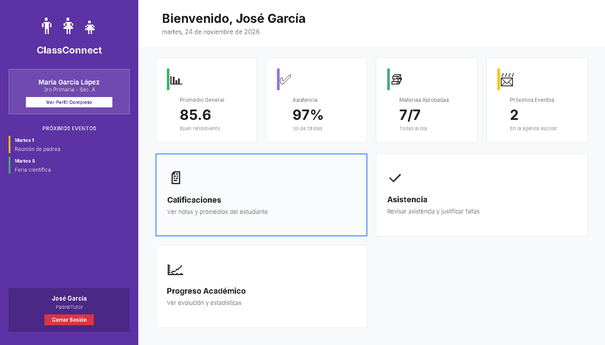
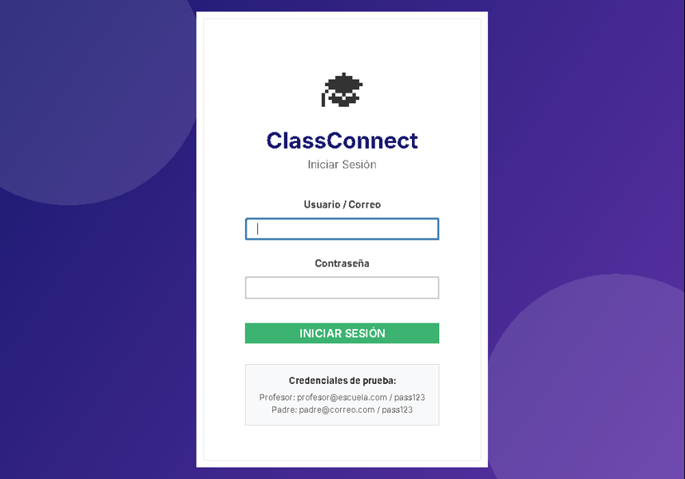
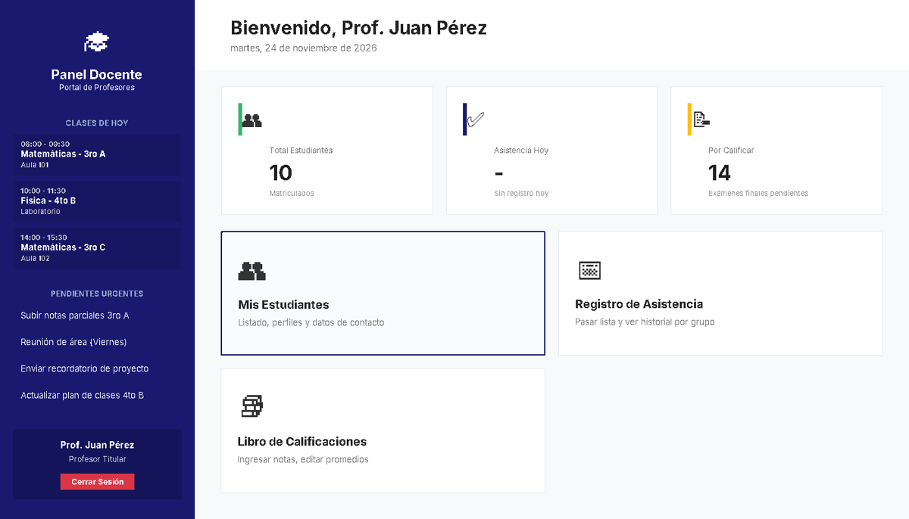
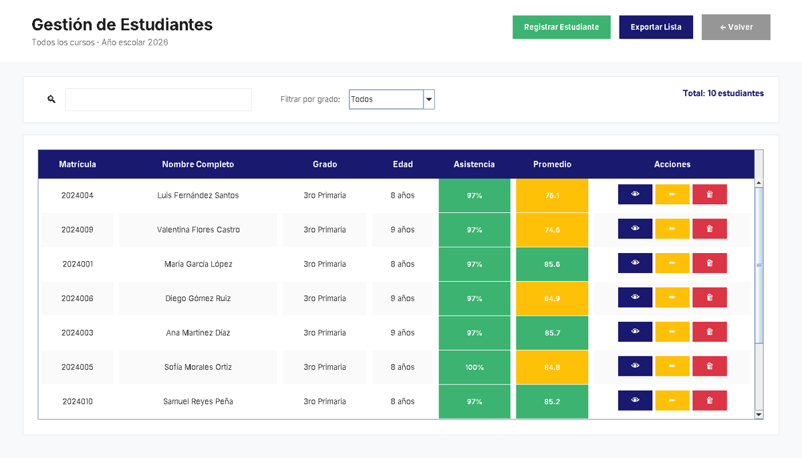
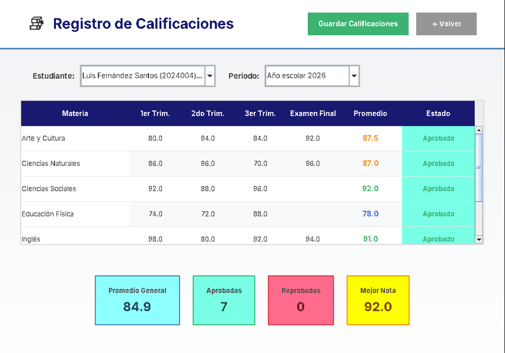
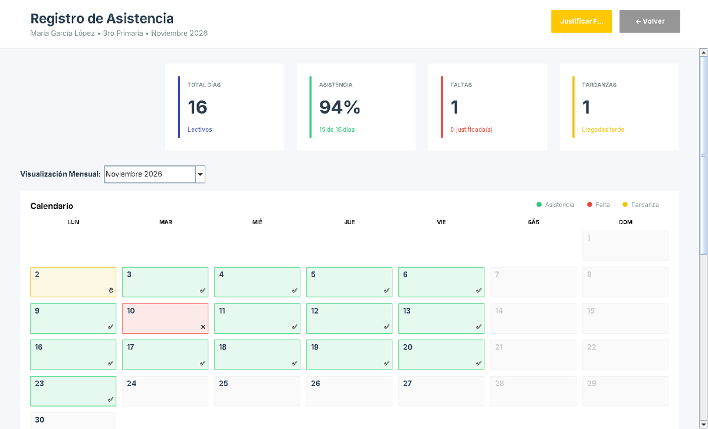

<h1 align="center">🏫 ClassConnect</h1>

<p align="center">
  <b>Desktop school manager that connects teachers and parents: attendance, grades and student progress in one place.</b><br/>
  <i>Gestor escolar de escritorio que conecta a docentes y padres: asistencia, calificaciones y progreso del estudiante en un solo lugar.</i>
</p>

<p align="center">
  
  
  
  
</p>

<p align="center">
  
</p>

---

## ✨ Features · Funcionalidades

### 👩‍🏫 Teacher portal · Portal docente
| EN | ES |
|---|---|
| Dashboard with live stats: students, today's attendance, pending finals | Panel con estadísticas reales: estudiantes, asistencia del día, exámenes pendientes |
| Student list with search, grade filter, view / edit / delete and CSV export | Lista de estudiantes con búsqueda, filtro por grado, ver / editar / eliminar y exportación CSV |
| Student registration (also creates the parent's account and links it) | Registro de estudiantes (crea y vincula la cuenta del padre/madre) |
| Daily attendance by grade and section | Pase de lista diario por grado y sección |
| Grade book: three terms + final exam per subject, with averages | Registro de notas: tres trimestres + examen final por materia, con promedios |

### 👨‍👩‍👧 Parent portal · Portal de padres
| EN | ES |
|---|---|
| Overview: average, attendance, passed subjects and upcoming school events | Resumen: promedio, asistencia, materias aprobadas y próximos eventos |
| Monthly attendance calendar and absence justification | Calendario mensual de asistencia y justificación de faltas |
| Grades by term with best / weakest subject | Calificaciones por período con mejor y peor materia |
| Academic progress analysis and downloadable report card | Análisis de progreso académico y boletín descargable |
| Student profile | Perfil del estudiante |

## 🖼️ Screenshots · Capturas

| Login | Teacher dashboard |
|---|---|
|  |  |
| **Students** | **Grade book** |
|  |  |
| **Parent attendance** | |
|  | |

## 🏗️ Architecture · Arquitectura

```
src/main/java
├─ com/interfazmaestro   Teacher screens (Swing)  · Pantallas del docente
├─ com/interfazpadre     Parent screens (Swing)   · Pantallas del padre/madre
├─ dao                   JDBC data access: users, students, attendance, grades, events
└─ Modelos               Entities, session and connection (configured by environment variables)
database
├─ schema.sql            13-table MySQL schema · Esquema de la base de datos
└─ seed.sql              Demo data · Datos de demostración
```

## 🚀 Run locally · Ejecutar localmente

**Requirements · Requisitos:** Java 17+, Maven 3.9+, MySQL 8.

**1. Database · Base de datos**

```bash
mysql -u root -p < database/schema.sql
mysql -u root -p < database/seed.sql
```

**2. Configure the connection · Configurar la conexión** (defaults: `localhost:3306`, user `root`, empty password)

```bash
export CLASSCONNECT_DB_URL="jdbc:mysql://localhost:3306/sistema_escolar"
export CLASSCONNECT_DB_USER="root"
export CLASSCONNECT_DB_PASS="your-password"
```

On Windows PowerShell use `$env:CLASSCONNECT_DB_PASS="your-password"`.

**3. Build and run · Compilar y ejecutar**

```bash
mvn clean package
java -jar target/ClassConnect.jar
```

**Demo accounts · Cuentas de prueba**

| Role | Email | Password |
|---|---|---|
| Teacher · Docente | `profesor@escuela.com` | `pass123` |
| Parent · Padre/Madre | `padre@correo.com` | `pass123` |

> Parents created from the registration form get the initial password `pass123`.

## 👥 Team · Equipo

| | |
|---|---|
| 👤 **Aliandy Jimenez** — [@AliaJimenez](https://github.com/AliaJimenez) | 👤 Liss Espiritu |
| 👤 Robert Leon | 👤 Cesar Hernandez |

*Academic project · Proyecto académico.* The full design document is available in [`Documentacion Classconnect.pdf`](Documentacion%20Classconnect.pdf).
